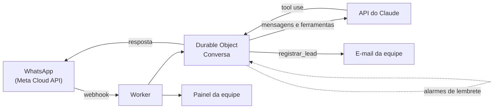

# Divinus WhatsApp Bot

Assistente de vendas com IA para o WhatsApp Business, feito com **Claude** (Anthropic) e uso de ferramentas (*tool use*), rodando em **Cloudflare Workers** e **Durable Objects**.

> Código de um produto real da [Divinus Tecnologia](https://divinustecnologia.com.br). Demonstração ao vivo do chatbot: [divinustecnologia.com.br/demo](https://divinustecnologia.com.br/demo).

## O que faz

- **Conversa de vendas pelo WhatsApp** (API oficial da Meta), guiada por um roteiro e por regras no prompt (`src/prompt.js`).
- **Ferramentas para o modelo (tool use):**
  - `registrar_lead`: envia à equipe, por e-mail, o resumo do interessado.
  - `encerrar_contato`: registra o opt-out e cancela os lembretes automáticos.
- **Lembretes de recuperação** agendados com alarmes dos Durable Objects: 15 min e 22 h (texto livre, dentro da janela de 24 h do WhatsApp) e 3 e 7 dias (templates aprovados), apenas entre 9h e 20h no horário de Belém.
- **Pausa de 12 h** quando alguém da equipe responde pelo aplicativo, e espera de 4 s para juntar mensagens em sequência antes de responder.
- **Painel da equipe** (`/painel`): conversas, leads e resposta manual.
- **Gerador de sites de demonstração** com assistente de IA por segmento (clínica, estética, imobiliária e veterinária) e chat para sites de clientes (`src/demo.js` e `src/sites.js`).

## Regras de segurança e privacidade

- Validação da assinatura dos webhooks da Meta.
- O prompt proíbe inventar preço, prazo, desconto ou resultado, e proíbe pedir CPF, CNPJ, dados de cartão ou senhas.
- Pedidos de exclusão de dados e de parada de mensagens (LGPD) são tratados pelo agente. Depois de um opt-out, nenhum lembrete é enviado.
- Limites de uso nas demonstrações (14 turnos e 500 caracteres por mensagem) para controlar o custo.

## Como funciona



Cada pessoa que conversa com o bot tem um Durable Object próprio, com o histórico e os lembretes agendados.

## Tecnologias

Cloudflare Workers, Durable Objects (SQLite), Cloudflare Email, WhatsApp Cloud API (Graph v26.0), `@anthropic-ai/sdk` (Claude Haiku 4.5) e JavaScript (ESM).

## Configuração

Variáveis públicas em `wrangler.toml`: `WA_PHONE_NUMBER_ID`, `GRAPH_VERSION`, `TEAM_EMAIL` e `FROM_EMAIL`. Os valores atuais são os canais de contato da Divinus; troque pelos seus.

Segredos, que ficam no Cloudflare e nunca no código (`npx wrangler secret put NOME`): `ANTHROPIC_API_KEY`, `WA_TOKEN`, `WA_APP_SECRET`, `WA_VERIFY_TOKEN` e `PAINEL_SENHA`.

## Publicar

```bash
npm install
npx wrangler deploy
npx wrangler tail   # logs
```

## Autor

**Filipe Borja Freitas Silva** · [GitHub](https://github.com/iTzB0r) · [LinkedIn](https://linkedin.com/in/filipe-borja-data)
